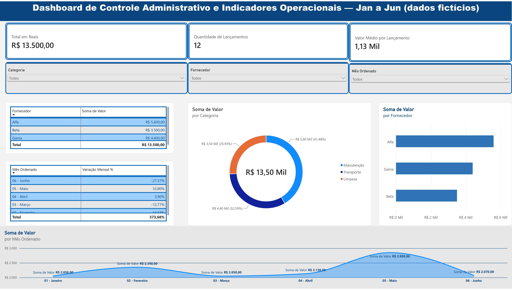

# Portfólio Power BI

Portfólio profissional de projetos de Business Intelligence, análise de dados e indicadores.

## Sobre este portfólio

Este repositório contém projetos desenvolvidos para prática e demonstração de competências em preparação de dados, construção de indicadores, visualização de informações e análise para apoio à tomada de decisão.

## Projetos

### Projeto 1 — Dashboard de Controle Administrativo e Indicadores Operacionais

- **Ferramenta:** Microsoft Power BI Desktop
- **Arquivo do projeto:** `Portifólio 1.1.pbix`
- **Objetivo de negócio:** acompanhar despesas administrativas por categoria, fornecedor e mês, com indicadores de total, volume de lançamentos, valor médio e variação mensal.
- **Fonte dos dados:** base fictícia `ControleAdministrativo` (lançamentos de janeiro a junho), criada para fins de estudo.
- **Tratamento dos dados:** importação e preparação no Power Query, incluindo coluna de mês ordenada para ordenação cronológica correta.
- **Indicadores e análises:** Total em Reais, Quantidade de Lançamentos, Valor Médio por Lançamento e Variação Mensal %; análises por categoria, por fornecedor e evolução mensal.
- **Principais conclusões:**
  - O fornecedor **Alfa** concentra o maior gasto do período (R$ 5.600,00), e a categoria **Manutenção** domina as despesas, respondendo por 41,5% do total — seguida de Transporte (32,6%) e Limpeza (25,9%).
  - **Maio** registrou o pico de despesas (R$ 2.850,00, alta de 33,8% sobre abril), seguido da maior queda do semestre em junho (-27,4%).
  - A tendência geral é de **oscilação**, sem direção estável: o semestre alterna altas e quedas, com volatilidade mais acentuada no fim do período (maio–junho).

#### Prévia do dashboard

#### Arquivos do projeto

- `Portifólio 1.1.pbix` — projeto completo, pronto para abrir no Power BI Desktop (gratuito).
- `dashboard.jpg` — prévia do painel.

## Competências demonstradas

- [x] Importação e preparação de dados no Power Query
- [x] Medidas e cálculos DAX
- [x] Indicadores-chave (KPIs)
- [x] Visualizações e filtros interativos
- [x] Validação dos resultados
- [x] Interpretação dos dados e recomendações

## Como visualizar

1. Veja a prévia em imagem aqui no GitHub.
2. Para explorar a versão interativa, baixe o arquivo `.pbix` e abra no Power BI Desktop (download gratuito no site da Microsoft).

## Observação sobre os dados

Os dados utilizados são **fictícios**, criados exclusivamente para fins de estudo e demonstração. Nenhuma informação real de empresas, clientes ou pessoas é publicada neste repositório.

## Contato

- LinkedIn: [rochele-caliari](https://www.linkedin.com/in/rochele-caliari-458a492a7)
